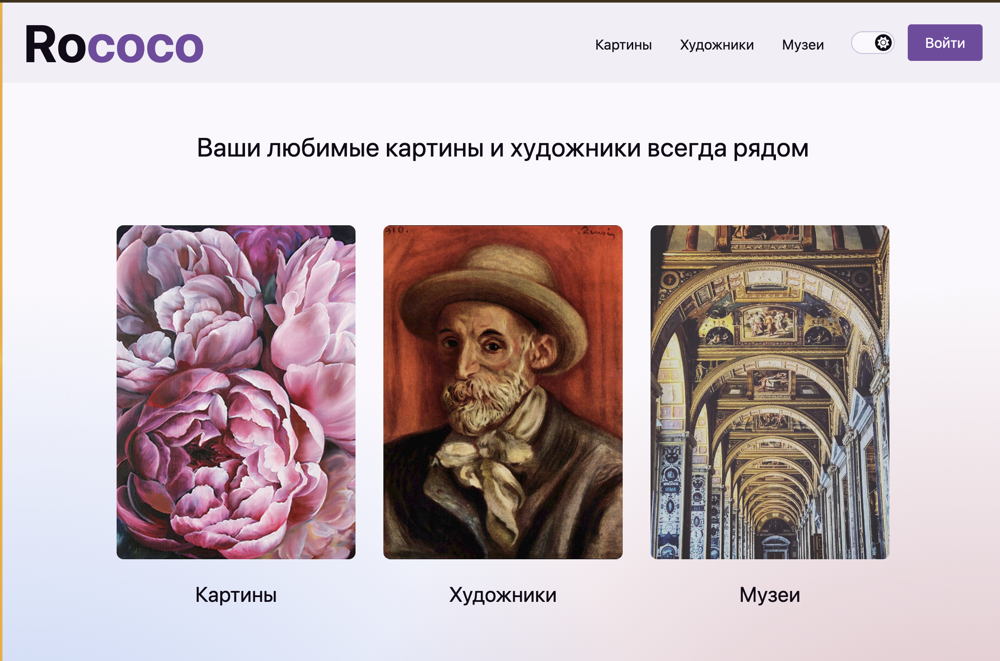
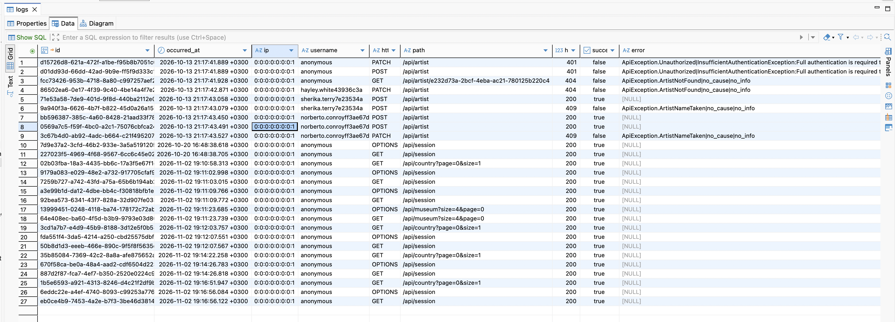
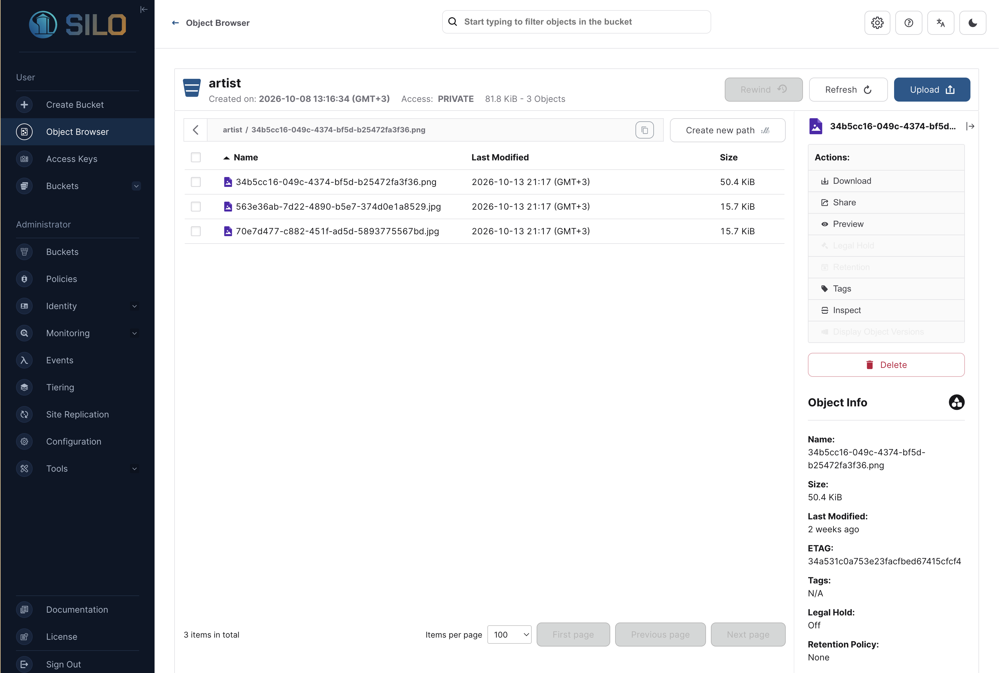
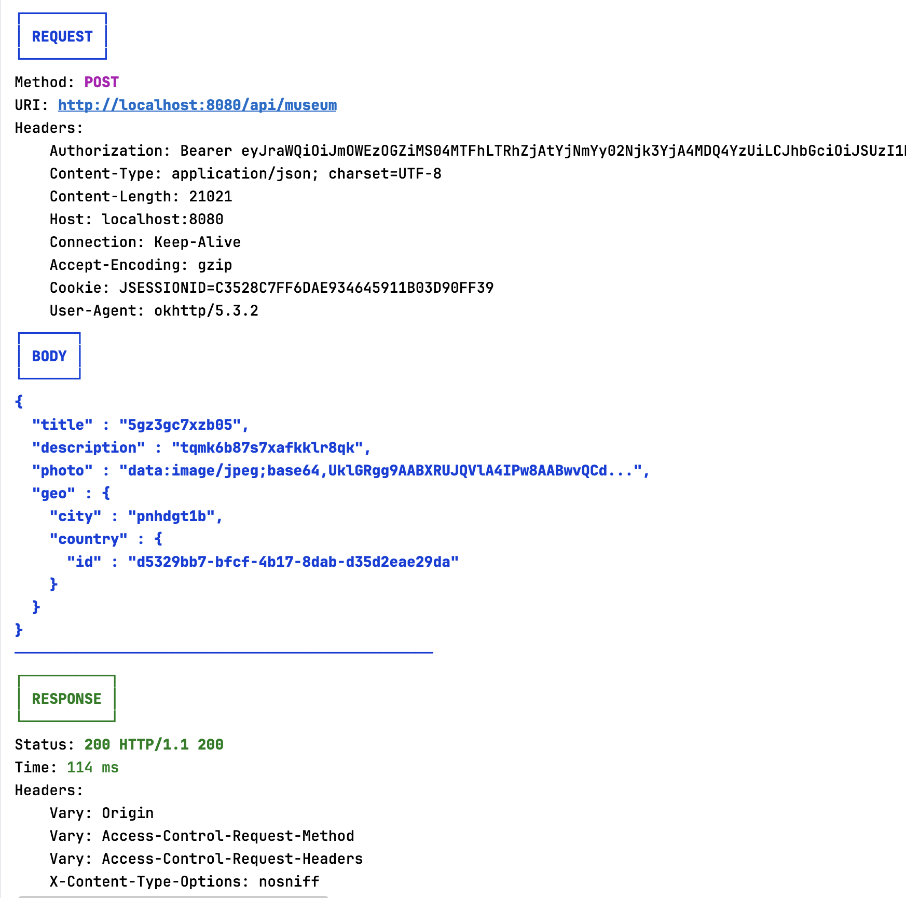
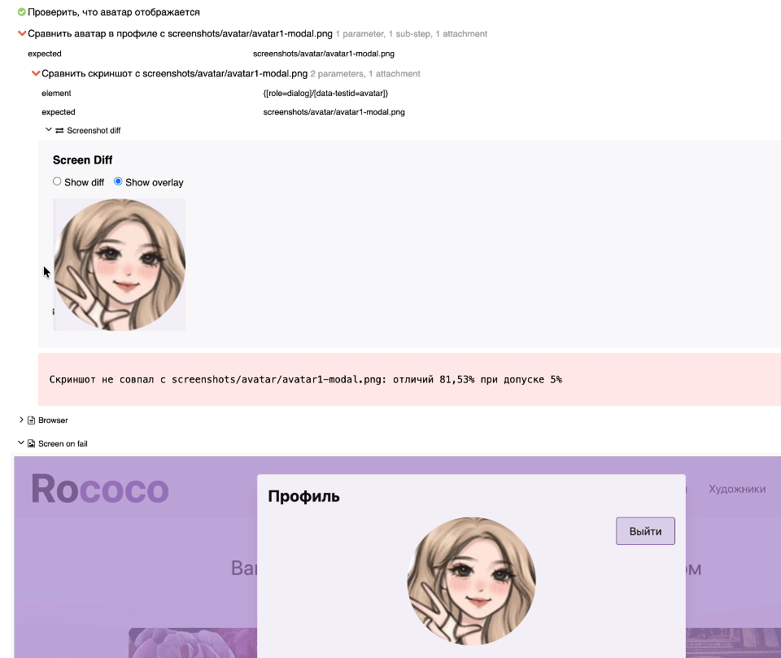
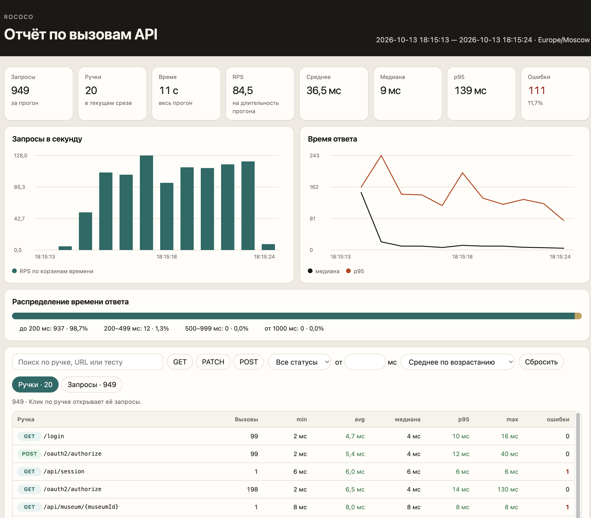

# Rococo

Учебный fullstack-проект галереи: художники, музеи, картины и профиль пользователя.  
Стек: **Spring Boot** (auth + gateway), **SvelteKit** (UI), **PostgreSQL / Kafka / MinIO**, e2e на **JUnit 5 + Selenide + Retrofit + Allure**.

| Сервис | Порт | Назначение |
| --- | --- | --- |
| `rococo-auth` | 9000 | OAuth2 / login / register |
| `rococo-gateway` | 8080 | REST API, JWT, Kafka, S3; Swagger UI |
| `rococo-client` | 3000 | Frontend |
| Postgres | 5433 | `rococo_auth`, `rococo_gateway` |
| Kafka | 9092 | UI на 8085 |
| MinIO | 9100 / 9101 | buckets: painting, museum, artist, avatar |

Swagger (только gateway): http://localhost:8080/swagger-ui/index.html

<p align="center">
  
</p>

## Быстрый старт

Нужны: **JDK 21**, **Docker Engine / Docker Desktop (должен быть запущен)**, **Node.js 18+**.

```bash
git clone git@github.com:mipkasnow/rococo.git
cd rococo
./run-services.sh
```

Скрипт поднимает Postgres / Kafka / MinIO, затем `rococo-auth`, `rococo-gateway`, `rococo-client`, ждёт готовности и открывает http://localhost:3000.  
Без запущенного Docker Engine infra не поднимется.  
Повторный запуск переиспользует уже отвечающие сервисы; образы Docker подтянутся только при первом `compose`/`run`.  
У `rococo-gateway` есть Swagger UI: http://localhost:8080/swagger-ui/index.html (у auth отдельного Swagger нет).

```bash
./run-services.sh stop   # гасит auth/gateway/client, которые стартовал скрипт
```

Контейнеры Rococo (`rococo-postgres`, `rococo-kafka`, `rococo-minio`) при `stop` не трогаются. Чужие контейнеры и процессы на занятых портах скрипт не убивает. Логи: `.run/`.

Ручной запуск по шагам по-прежнему доступен: `./localenv.sh`, `./kafka.sh`, `./minio.sh`, `./ports.sh`, `./gradlew …:bootRun`, `npm run dev`.

## Тесты

```bash
# unit / integration gateway (нужен Docker для integration)
./gradlew :rococo-gateway:unitTests
./gradlew :rococo-gateway:integrationTests

# принудительный прогон без UP-TO-DATE-кэша
./gradlew :rococo-gateway:unitTests --rerun-tasks

# e2e (нужен поднятый стенд)
./gradlew :e2e:test
```

В консоли видны статусы `PASSED` / `FAILED` / `SKIPPED` и итоговая строка с числом тестов.  
Если Gradle пишет `UP-TO-DATE` за секунду — это кэш предыдущего успешного прогона, не «пустой» suite; добавь `--rerun-tasks`.

Allure-результаты: `e2e/build/allure-results`.  
Отчёт по API-таймингам после e2e: `e2e/build/reports/api-performance/index.html`.

### Unit-тесты (Mockito)

В `rococo-gateway` сервисы покрыты юнит-тестами с `@UnitTest` (JUnit 5 + MockitoExtension). Репозитории и S3 мокаются, проверяется бизнес-логика без Spring-контекста.

```java
@UnitTest
class ArtistServiceTest {

    @Mock ArtistRepository artistRepository;
    @Mock S3FileService s3FileService;
    @InjectMocks ArtistService artistService;

    @Test
    void update_shouldThrowException_whenNameIsTaken() {
        when(artistRepository.findByIdOrThrow(artistId)).thenReturn(artist(new FileEntity()));
        when(artistRepository.existsByNameAndIdNot(name, artistId)).thenReturn(true);

        assertApiException(
                ErrorCode.ArtistNameTaken,
                () -> artistService.update(new ArtistUpdateRequest(artistId, name, biography, photo))
        );
    }
}
```

### Интеграционные тесты (Testcontainers + Spring Boot Test)

`@IntegrationTest` поднимает Spring Boot + MockMvc и инфраструктуру через Testcontainers (PostgreSQL, Kafka, MinIO). Это полный HTTP-прогон API на реальных контейнерах.

```java
@IntegrationTest
class CountryControllerTest {

    @Autowired
    private ApiClient api;

    @Test
    void pageAndSizeSliceTheList() {
        List<CountryDto> all = allCountries();
        PageResponse<CountryDto> page = countries(1, 2);

        assertThat(page.page().number()).isEqualTo(1);
        assertThat(page.content()).containsExactlyElementsOf(all.subList(2, 4));
    }
}
```

## Kafka: лог API-событий

Каждый значимый вызов API gateway публикует событие в Kafka; consumer пишет его в таблицу логов. В Kafka UI видно поток сообщений по топику.



## MinIO (S3): хранение картинок

Фото художников, музеев, картин и аватаров кладутся в MinIO (S3-совместимое API). Отдельные buckets: `painting`, `museum`, `artist`, `avatar`. Gateway ходит в MinIO через AWS SDK.



## Pretty HTTP-лог (Retrofit / OkHttp)

Вместо сырого OkHttp-дампа — свой `PrettyHttpLoggingInterceptor`: цветной request/response, pretty JSON, обрезка data-url/base64, подсветка медленных ответов. Удобно читать прогон в консоли и в CI-логах.



## Screenshot-тесты (AShot + Allure)

UI сравнивается с эталоном через `ScreenDiff` (AShot): допуск по пикселям, expected / actual / diff уезжают в Allure. Перезаписать эталоны: `-Dscreenshot.override=true`.



## Jupiter extensions

Мета-аннотации собирают набор extensions для web/rest:

```java
@ExtendWith({
        TestMethodContextExtension.class,
        InjectDependenciesExtension.class,
        BrowserExtension.class,
        ApiLoginExtension.class,
        CookieExtension.class,
        AllureJunit5.class
})
public @interface WebTest {
}
```

`InjectDependenciesExtension` сам создаёт и подставляет в поля теста клиенты из `api.client` (и static, и instance) — без ручного `new MuseumApiClient()` в каждом классе.

`@ApiLogin` регистрирует пользователя через auth API, кладёт JWT в store и (для web) пишет `id_token` в localStorage:

```java
@Test
@ApiLogin
@Museums(count = 3)
@DisplayName("Список музеев совпадает с API, поиск находит Русский музей")
void museumsShouldMatchApiAndSearch() { /* ... */ }
```

Создание сущностей по аннотации — без boilerplate в тесте:

```java
@Override
public void beforeEach(ExtensionContext context) {
    AnnotationSupport.findAnnotation(context.getRequiredTestMethod(), Artist.class)
            .ifPresent(artist -> {
                ArtistResponse created = artistApiClient.create(new ArtistCreateRequest(
                        value(artist.name(), 12),
                        value(artist.biography(), 20),
                        DataUrl.fromClasspath(PHOTO)
                ));
                context.getStore(NAMESPACE).put(context.getUniqueId(), created);
            });
}
```

Suite-хуки через root `ExtensionContext` + `CloseableResource` — один `beforeSuite` / `afterSuite` на весь прогон (очистка данных, HTML-отчёт по RPS):

```java
rootContext.getStore(ExtensionContext.Namespace.GLOBAL)
        .getOrComputeIfAbsent(
                this.getClass(),
                key -> {
                    beforeSuite(rootContext);
                    return (ExtensionContext.Store.CloseableResource) this::afterSuite;
                }
        );
```

OkHttp interceptor пишет каждый Retrofit-вызов в коллектор; после suite собирается интерактивный отчёт (RPS, latency, p95, группировка по ручкам).

Параллельный прогон e2e опирается на `ThreadSafeCookieStore` и очистку cookies между тестами; SQL из JDBC (P6Spy) уходит в Allure как attachments; для списков на UI есть кастомные Selenide `WebElementsCondition` (например `MuseumConditions`).

## Пример отчёта RPS / latency

Скриншот реального прогона:



Интерактивный HTML (открыть локально в браузере):  
[e2e/src/test/resources/samples/rps-stat-report.html](e2e/src/test/resources/samples/rps-stat-report.html)

## Модули

- `rococo-auth` — Authorization Server
- `rococo-gateway` — API, JPA/Flyway, Kafka, MinIO
- `rococo-client` — SvelteKit UI
- `e2e` — UI/API автотесты, JDBC-репозитории, Allure, API timing report
